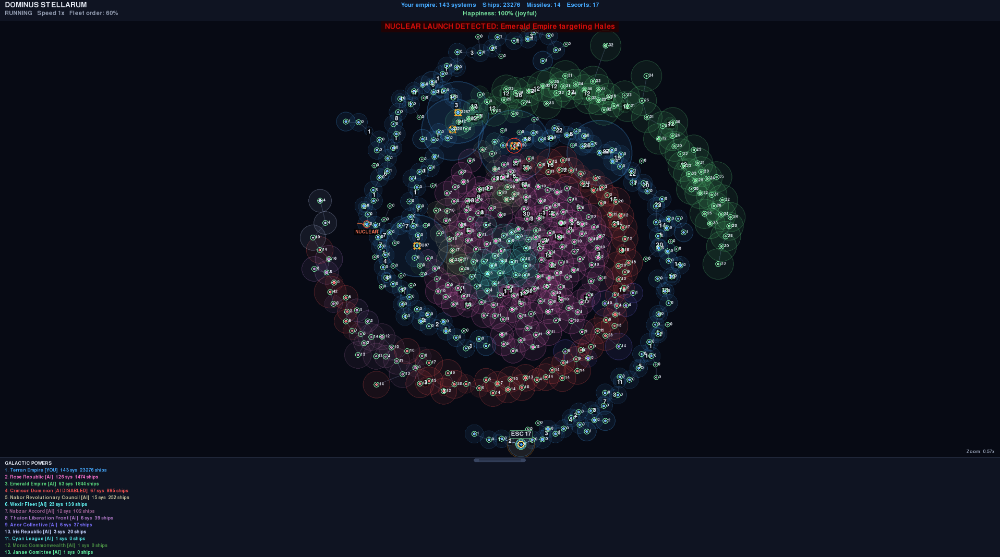

# Dominus Stellarum

A real-time 4X space strategy game built with Python and pygame. 

Claim a foothold in a procedurally generated spiral galaxy, expand through a network of hyperlanes, and outmanoeuvre rival empires. Build up your fleets, establish gathering points, unleash nuclear strikes, and keep your population loyal—or risk watching your empire fracture from within.

[**Download a release**](https://github.com/hermonochy/Dominus-Stellarum/releases) · [Report a bug](https://github.com/hermonochy/Dominus-Stellarum/issues) · [View the source](https://github.com/hermonochy/Dominus-Stellarum/game)



## Getting started

### Download a release

The [Releases page](https://github.com/hermonochy/Dominus-Stellarum/releases) contains packaged builds when available. Download the build for your operating system, and launch the executable.

macOS users may need to run the game from source if a macOS package is not provided for the release.

### Building from source


#### Requirements

- Python 3.10 or newer recommended
- pygame

Clone the repository and enter the project directory:

```bash
git clone https://github.com/hermonochy/Dominus-Stellarum.git
cd Dominus-Stellarum
```

Create and activate a virtual environment:

#### Windows

```powershell
python -m venv .venv
.venv\Scripts\activate
```

#### macOS/Linux

```bash
python3 -m venv .venv
source .venv/bin/activate
```

Install the dependencies:

```bash
pip install -r requirements.txt
```

## Running the game

If you built from source, start the game with:

```bash
python main.py
```

On systems where Python is invoked as `python3`, use:

```bash
python3 main.py
```

## How to play

You begin with a home system and a fleet. Systems under your control produce ships over time. Expand into neutral territory, reinforce vulnerable borders, and attack rival empires. Fleets travel along the hyperlanes shown on the map, so controlling routes and chokepoints is key. The objective is simple: to become the **last empire controlling the galaxy**. Victory is awarded when one empire controls every system; AI empires can win too.

### Fleet orders

1. **Select a system:** Left-click one of your systems.
2. **Choose a destination:** Right-click another system to send a fleet.
3. **Choose the force:** Use the number keys to send a small fixed number of ships, or the function keys to send a percentage of the available fleet.
4. **Plan around the map:** Fleets can only travel along connected hyperlanes.

#### Gathering points

To avoid manually sending newly generated ships to frontier planets, **Middle-click** any system (yours, neutral, or enemy) to toggle it as a gathering point, marked with an orange reticle. Your systems automatically send newly produced ships to gathering points, choosing the best one based on:

- **Distance** — closer gathering points are preferred.
- **Vulnerability** — thinly defended gathering points receive priority over ones already well stocked.
- **Safe passage** — routes that would cross enemy territory are avoided. If a gathering point cannot be reached without passing through hostile space, your ships stay home rather than fly to their deaths.

Gathering points persist even if the system changes hands — place one deep in enemy space to stage an invasion, or hold a contested chokepoint.

#### Nuclear Warfare

Arm nuclear targeting with N, then right-click an enemy system to launch. The missile destroys all ships in its blast radius and damages nearby systems. Both launcher and victim suffer citizen morale penalties—use carefully to avoid triggering rebellions.

#### Revolts and Betrayals

Empires grow restless after heavy casualties or nuclear strikes. When citizen happiness drops too low, systems may defect:

- Betrayal: A planet joins a neighboring empire
- Revolt: Multiple systems in a sector rise together, forming a new independent rebellion

Maintain morale by capturing new territory or reduce casualties. Neglect invites revolt.

### Controls

| Action | Control |
| --- | --- |
| Select one of your systems | Left mouse button |
| Send a fleet to a system | Right mouse button |
| Pan the view | Drag with middle mouse button |
| Toggle a gathering point | Click planet with middle mouse button |
| Zoom in / out | Mouse wheel |
| Pan the view | Arrow keys |
| Send X ships from the selected planet | 1–9 |
| Send Y% of the fleet | F1–F10 |
| Toggle nuclear targeting | `N` |
| Pause or resume the simulation | `Space` |
| Increase simulation speed | `+` or `=` |
| Decrease simulation speed | `-` |
| Toggle fullscreen | `F` |
| Exit fullscreen (or quit the game) | `Esc` |
| Start a new game | `R` |

## Future Work

- Alliances
- Storyline
- Power boosts
- Better balance
- Different empire personalities
